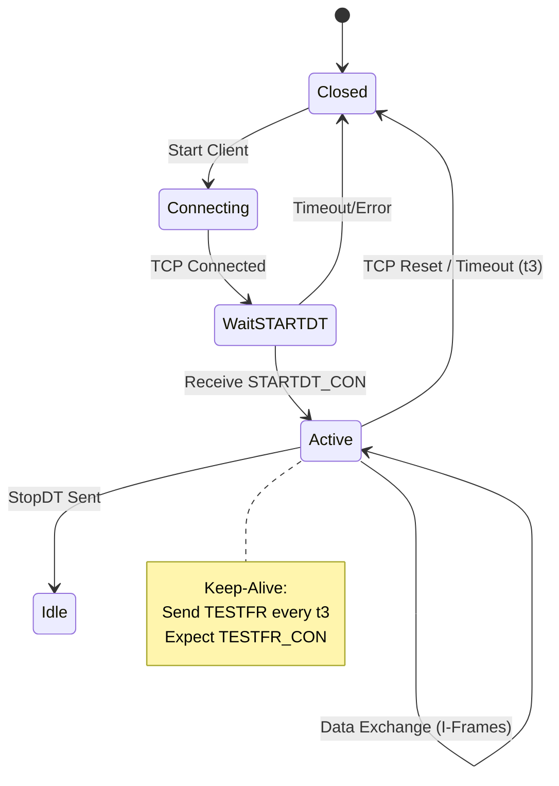

# IEC 104 Protocol Validation & Project Advancement

## 1. Conceptual & Architectural Validation

### Roles: Controlling vs. Controlled
*   **Controlling Station (Client/SCADA)**: The initiator of connections and commands. It sends interrogation commands (General Interrogation) and control commands (Switch Close/Trip). It receives measurement data.
*   **Controlled Station (Server/RTU)**: The passive station that listens for connections. It gathers data from the field (sensors, devices) and sends it to the Client (either unsolicited or upon request). It executes commands received from the Client.
*   **Current Simulation**: We are validating **BOTH**.
    *   `server.py` implements the **Controlled Station** (RTU/Server).
    *   `main.py` implements the **Controlling Station** (Client/SCADA) with a GUI.

### TCP Port & Architecture
*   **Standard Port**: `2404` (IANA assigned).
*   **Handling Concurrent Clients (Server Side)**:
    *   The architecture MUST maintain **separate connection contexts** (Sockets/Sessions) for each connected Client.
    *   However, they typically share the same underlying **Data Model (Information Objects)**.
    *   **Critical Implementation Detail**: Write operations to the `server_state` (like in `server.py`) must be thread-safe if multiple clients can command the same points simultaneously. In `server.py`, the `server_state` is a global instance; ensuring atomic updates or using a locking mechanism is best practice if the asyncio event loop were to become multi-threaded or if complex logic yields during updates.

### APDU Structure
*   **APDU (Application Protocol Data Unit)** = APCI + ASDU.
*   **Boundary**:
    *   **APCI (Application Protocol Control Information)**: The first **6 bytes** (Start, Length, Control Fields).
    *   **ASDU (Application Service Data Unit)**: The remaining payload (Bytes 6 to `Length+1`). Contains the actual SCADA data and addressing headers.

---

## 2. Protocol Logic & Handshake (The State Machine)

### STARTDT Handshake
Before **ANY** process data (I-Frames) can be exchanged, the Data Transfer must be activated.
1.  **Client sends**: `STARTDT Act` (U-Frame).
    *   Hex: `68 04 07 00 00 00`
2.  **Server responds**: `STARTDT Con` (Acknowledgment).
    *   Hex: `68 04 0B 00 00 00`
*   *Note*: If the Server does not receive `STARTDT`, it should discard any I-Frames or S-Frames received (connection is not yet "active").

### Frame Formats
*   **I-Frame (Information)**: Contains ASDU data (Process info, Commands).
    *   **Logic**: Increments `N(S)` (Send Sequence) and acknowledges receiving frames via `N(R)` (Receive Sequence).
*   **S-Frame (Supervisory)**: Pure Acknowledgment. contains **no** data (ASDU).
    *   **Trigger Condition**: Sent when the station has received `k` (usually 8) I-Frames from the peer but has no I-Frames of its own to send. It effectively says "I have received up to frame number X, but I have no data for you right now."
*   **U-Frame (Unnumbered)**: Control functions (STARTDT, STOPDT, TESTFR).
    *   **Logic**: Does not increment sequence numbers. Used for connection maintenance.

### Sequence Numbers N(R) and N(S)
*   **N(S)**: Sender's counter. Incremented by 1 for every I-Frame sent.
*   **N(R)**: Receiver's counter. Value = `N(S)` of the *next expected* frame. Acknowledges all frames < `N(R)`.
*   **Out of Order Logic**:
    *   If `Received N(S) != Local V(R)` (Expected Receive Variable):
    *   **Action**: This implies a TCP stream issue or packet loss/injection (which shouldn't happen on healthy TCP). The standard dictates **Closing the Connection**. IEC 104 relies on TCP for ordering; if an application gap occurs, the state is effectively desynchronized.

---

## 3. Data Parsing & Encoding

### Byte Structure: TypeID 1 vs. TypeID 45
*   **TypeID 1 (M_SP_NA_1 - Single Point)**:
    *   **Mandatory Fields**: IOA (3 bytes), SIQ (1 byte - Single Point Information Quality).
    *   SIQ Bits: `[IV | NT | SB | BL | RES | RES | RES | SPI]` (SPI = Value).
*   **TypeID 45 (C_SC_NA_1 - Single Command)**:
    *   **Mandatory Fields**: IOA (3 bytes), SCO (1 byte - Single Command Object).
    *   SCO Bits: `[SCS (Value) | RES | ... | QOC (Qualifier)]`.

### Extracting COT and IOA
Assumptions: Standard APDU layout.
*   **APCI**: 6 Bytes.
*   **ASDU Header**:
    *   Byte 0: TypeID
    *   Byte 1: SQ/Num
    *   **COT (Cause of Transmission)**: Bytes 2-3 (if standard defines 2 octets, typically Cause + Originator).
        *   **Parser Offset**: APDU Byte 8 (Cause) and Byte 9 (Originator).
    *   **Common Address (CA)**: Bytes 4-5.
*   **IOA (Information Object Address)**:
    *   Starts at **ASDU Byte 6** (APDU Byte 12).
    *   Length: 3 Bytes (Low, Mid, High).

### Structure Qualifier (SQ) Bit
Found in the Variable Structure Qualifier (VSQ) byte (ASDU Byte 1).
*   **SQ = 0 (Individual)**:
    *   Structure: `[IOA1][Value1], [IOA2][Value2], [IOA3][Value3]...`
    *   Used when points are not contiguous.
*   **SQ = 1 (Sequence)**:
    *   Structure: `[IOA_Start][Value1][Value2][Value3]...`
    *   Prerequisite: Points must have **contiguous** addresses (IOA, IOA+1, IOA+2...). Efficient for bulk data.

---

## 4. "The Golden Test": Hex Decoding

**Raw String**: `68 0E 00 00 00 00 64 01 06 00 01 00 00 00 00 14`

### Breakdown:

| Byte(s) | Value | Interpretation |
| :--- | :--- | :--- |
| **0** | `68` | **Start Byte** |
| **1** | `0E` | **Length (14 bytes)** (Remaining valid frame size) |
| **2-5** | `00 00 00 00` | **APCI (Control Field)** |
| | | - Type: **I-Frame** (Bit 0 of 1st octet is 0) |
| | | - **N(S) = 0** |
| | | - **N(R) = 0** |
| **6** | `64` | **TypeID 100** (C_IC_NA_1) |
| **7** | `01` | **VSQ**: SQ=0, Count=1 |
| **8** | `06` | **COT**: Activation (Cause=6) |
| **9** | `00` | **Originator Address**: 0 |
| **10-11**| `01 00` | **Common Address (CA)**: 1 |
| **12-14**| `00 00 00` | **IOA**: 0 |
| **15** | `14` | **QOI (Qualifier of Interrogation)**: 20 (Station Interrogation) |

### Real-World Context
This frame is a **General Interrogation (Station Interrogation)** command sent by the **Controlling Station (Client)** to the **Controlled Station (RTU)**. It usually happens immediately after the `STARTDT` handshake. The Client is asking: *"Please send me the current values of ALL your monitored points."*

---

## 5. Project Advancement Prompts

### A. State Transition Diagram logic
(Network Disconnection & Reconnection)


### B. CP56Time2a Helper Function (Python)
```python
import struct
from datetime import datetime

def datetime_to_cp56(dt: datetime) -> bytes:
    """
    Convert datetime to 7-byte IEC 104 CP56Time2a format.
    """
    # Milliseconds (0-59999)
    ms_val = int(dt.microsecond / 1000) + (dt.second * 1000)
    
    # Minutes (0-59) - Bit 7 is IV (Invalid) which we default to 0 (Valid)
    minute_val = dt.minute
    
    # Hours (0-23) - Bit 7 is SU (Summer Time)
    hour_val = dt.hour
    # IF DST logic required: if is_dst(dt): hour_val |= 0x80
    
    # Day of Month (1-31) + Day of Week (top 3 bits, optional but often used)
    # Day of week ISO: 1=Mon...7=Sun. IEC usually 1-7.
    day_val = dt.day 
    # Optional: Encode Day of Week in top 3 bits:
    # dow = dt.isoweekday()
    # day_val |= (dow << 5)
    
    month_val = dt.month
    year_val = dt.year % 100  # 0-99
    
    # Pack: H(2 bytes ms), B(min), B(hour), B(day), B(mon), B(year)
    return struct.pack('<HBBBBB', ms_val, minute_val, hour_val, day_val, month_val, year_val)
```

### C. "Silent Failures" Checklist
1.  **TESTFR Ignorance**: Receiving a `TESTFR Act` and failing to reply with `TESTFR Con`.
    *   *Result*: The peer will think the connection is dead and close the TCP socket after timeout `t1`.
2.  **Sequence Number Desync**: Failing to increment `N(R)` correctly or acknowledging wrong numbers.
    *   *Result*: Peer stops sending data (window `k` fills up) or closes connection.
3.  **Unacknowledged Commands**: Receiving a Command (Type 45) but not sending a mirrored Activation Confirmation (COT 7).
    *   *Result*: The SCADA system will mark the command as "Timeout/Failed" and may retry indefinitely or alarm.
4.  **STARTDT Race Condition**: Sending I-Frames *before* receiving `STARTDT Con`.
    *   *Result*: Frames may be ignored/dropped by strict implementations.
