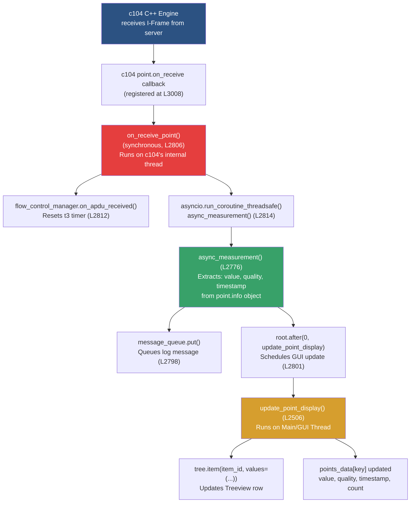

# IEC 104 Client (`client104.py`) — Complete Validation

> All answers reference the actual implementation in [client104.py](file:///c:/nexus-project/nexus-api/iiot_gateway_project/services/device_management/protocol/IEC104/example/read_write/agent/client104.py) (3278 lines).

---

## Phase 1: Architecture & Code Structure Understanding

### 1.1 Sequence Diagram — "Connect" Button Click → TCP Connection

```mermaid
sequenceDiagram
    participant User
    participant GUI as IEC104ClientGUI<br/>(Main Thread)
    participant Thread as Client Thread<br/>(Daemon)
    participant Loop as asyncio Event Loop
    participant c104 as c104 Library
    participant Server as IEC 104 Server

    User->>GUI: Click "Connect" button
    GUI->>GUI: manual_connect() [L2143]
    GUI->>GUI: _stop_reconnect = False
    GUI->>GUI: connect_button → DISABLED
    GUI->>GUI: start_iec104_client() [L3182]
    GUI->>Thread: threading.Thread(target=run_iec104_client) [L3185]
    Thread->>Loop: asyncio.new_event_loop() [L3191]
    Loop->>Loop: iec104_client_main() [L2921]

    Note over Loop: --- Client Setup Phase ---
    Loop->>c104: c104.Client() [L2949]
    Loop->>c104: client.add_connection(ip, port) [L2950]
    Loop->>c104: connection.add_station(common_address=47) [L2955]

    Note over Loop: --- Point Registration Phase ---
    loop For each group in station_config.groups
        loop For each data_point in group.points
            Loop->>c104: station.add_point(ioa, type) [L3001]
            Loop->>c104: point.on_receive(callback) [L3008]
            Loop->>Loop: monitoring_points[ioa] = point [L3013]
        end
    end

    Note over Loop: --- Connection Phase ---
    Loop->>c104: client.start() [L3028]
    c104->>Server: TCP SYN → TCP Handshake
    c104->>Server: STARTDT_ACT (U-Frame)
    Server-->>c104: STARTDT_CON (U-Frame)

    Loop->>Loop: Poll connection.state != OPEN [L3034]
    Loop-->>Loop: ConnectionState.OPEN detected
    Loop->>GUI: root.after(0, update_connection_status, "CONNECTED") [L3048]
    Loop->>Loop: flow_control_manager.start(loop) [L3056]
    Loop->>Loop: time_sync_manager.start_auto_sync(loop) [L3065]

    Note over Loop: --- Active Data Exchange ---
    Loop->>Loop: Main command processing loop [L3068]
```

**Key points:**
- The "Connect" button triggers [manual_connect()](file:///c:/nexus-project/nexus-api/iiot_gateway_project/services/device_management/protocol/IEC104/example/read_write/agent/client104.py#L2143-L2159) on the **GUI thread**
- A **daemon thread** is spawned via [start_iec104_client()](file:///c:/nexus-project/nexus-api/iiot_gateway_project/services/device_management/protocol/IEC104/example/read_write/agent/client104.py#L3182-L3187) which creates its own **asyncio event loop**
- The actual TCP connection is handled internally by `c104.Client.start()` — the code **polls** `connection.state` in a loop with 0.5s sleep intervals and a 30s timeout [L3034-L3039]
- The c104 library handles the STARTDT handshake internally

---

### 1.2 Data Flow — Server Value → Tkinter Treeview



**The full journey:**

| Step | Thread | Function | Line |
|------|--------|----------|------|
| 1 | c104 internal | C++ callback fires | — |
| 2 | c104 internal | `on_receive_point()` | L2806 |
| 3 | asyncio loop thread | `async_measurement()` | L2776 |
| 4 | GUI thread (via `root.after`) | `update_point_display()` | L2506 |
| 5 | GUI thread | `tree.item()` updates Treeview | L2516 |

The critical thread boundary crossing is `root.after(0, ...)` at L2801, which schedules the Treeview update on Tkinter's main thread — **mandatory** because Tkinter is not thread-safe.

---

### 1.3 Why Both `message_queue` and `command_queue`?

Both queues are defined at [L1465-L1466](file:///c:/nexus-project/nexus-api/iiot_gateway_project/services/device_management/protocol/IEC104/example/read_write/agent/client104.py#L1465-L1466):

```python
self.message_queue = queue.Queue()   # Server → GUI (data direction)
self.command_queue = queue.Queue()   # GUI → Server (command direction)
```

| Aspect | `message_queue` | `command_queue` |
|--------|-----------------|-----------------|
| **Direction** | Background thread → GUI thread | GUI thread → Background thread |
| **Content** | Log entries, status updates | User commands (ON/OFF, WRITE, READ, SYNC) |
| **Consumer** | `process_queue()` on GUI thread (L2726) | `iec104_client_main()` main loop (L3075) |
| **Producer** | `log_message()` from any thread | Button handlers like `send_on_command()` (L2702) |

**Race conditions prevented:**

1. **Tkinter thread-safety**: Tkinter widgets can only be modified from the main thread. Without `message_queue`, the background thread would directly call `self.traffic_tree.insert(...)`, causing **random crashes or UI corruption**.

2. **c104 callback thread-safety**: The `on_receive_point` callback runs on c104's internal thread. Without queuing, it would attempt to modify `self.tree` (Treeview) directly — **undefined behavior** in Tkinter.

3. **Command atomicity**: Without `command_queue`, clicking "ON" while the background loop is mid-iteration would cause **concurrent access** to `c104.Point` objects. The queue serializes command execution within the asyncio loop.

4. **Write-after-disconnect**: If the user clicks "Write" right as the connection drops, without the queue the code would call `point.transmit()` on a stale/null point. The queue allows the consumer to check connection state before executing [L3068-L3071].

---

### 1.4 StationConfig — Auto-Generation & Overlapping IOAs

**Auto-generation mechanism:**

The `DataGroup.__post_init__()` method at [L139-L142](file:///c:/nexus-project/nexus-api/iiot_gateway_project/services/device_management/protocol/IEC104/example/read_write/agent/client104.py#L139-L155) auto-generates `DataPoint` objects:

```python
def __post_init__(self):
    if not self.points:
        self.points = self._generate_points()

def _generate_points(self) -> list:
    generated = []
    for i in range(self.quantity):
        ioa = self.start_ioa + i          # Sequential IOAs
        point = DataPoint(
            ioa=ioa,
            name=f"{self.group_name}_{i+1}",  # e.g., "Digital_Inputs_1"
            asdu_type=self.asdu_type
        )
        generated.append(point)
    return generated
```

For a group with `start_ioa=100, quantity=10`, this creates IOAs: 100, 101, 102, ..., 109.

**Overlapping IOA handling:**

The `StationConfig.add_group()` method at [L218-L229](file:///c:/nexus-project/nexus-api/iiot_gateway_project/services/device_management/protocol/IEC104/example/read_write/agent/client104.py#L218-L242) validates all new groups against existing ones:

```python
def add_group(self, group: DataGroup):
    for existing in self.groups:
        if self._groups_overlap(existing, group):
            raise ValueError(
                f"IOA overlap between '{existing.group_name}' "
                f"({existing.start_ioa}-{existing.get_end_ioa()}) and ..."
            )
    self.groups.append(group)
```

The `_groups_overlap()` method at [L231-L242](file:///c:/nexus-project/nexus-api/iiot_gateway_project/services/device_management/protocol/IEC104/example/read_write/agent/client104.py#L231-L242) checks overlap **regardless of ASDU type**:

```python
def _groups_overlap(self, g1, g2) -> bool:
    # c104 library requires unique IOAs - check overlap across ALL types
    end1 = g1.start_ioa + g1.quantity - 1
    end2 = g2.start_ioa + g2.quantity - 1
    return not (end1 < g2.start_ioa or end2 < g1.start_ioa)
```

> [!IMPORTANT]
> Although IEC 60870-5-104 conceptually allows different ASDU types to share IOAs, the c104 library uses IOA as a **unique identifier** within a station. Therefore, if two groups overlap (e.g., `M_SP_NA_1` at IOA 100-109 and `M_ME_NC_1` at IOA 105-114), a `ValueError` is raised — even though they have different types.

---

### 1.5 FlowControlManager Integration

The `FlowControlManager` is integrated into the main client loop as follows:

**Creation** — Inside [iec104_client_main()](file:///c:/nexus-project/nexus-api/iiot_gateway_project/services/device_management/protocol/IEC104/example/read_write/agent/client104.py#L2958-L2963):
```python
self.flow_control_manager = FlowControlManager(
    config=self.flow_config,
    on_send_testfr=send_testfr_callback,
    on_connection_timeout=connection_timeout_callback,
    on_log=self.log_message
)
```

**Start** — After connection is established [L3056]:
```python
self.flow_control_manager.start(loop)
```

**APDU feed** — Every time a point value arrives, `on_receive_point()` at [L2811-L2812](file:///c:/nexus-project/nexus-api/iiot_gateway_project/services/device_management/protocol/IEC104/example/read_write/agent/client104.py#L2811-L2812) resets the t3 timer:
```python
if self.flow_control_manager:
    self.flow_control_manager.on_apdu_received()
```

**Stop triggers:**
1. **User disconnect** — `manual_disconnect()` at [L2167-L2168](file:///c:/nexus-project/nexus-api/iiot_gateway_project/services/device_management/protocol/IEC104/example/read_write/agent/client104.py#L2167-L2168) calls `flow_control_manager.stop()`
2. **Connection lost** — Main loop exit at [L3110-L3112](file:///c:/nexus-project/nexus-api/iiot_gateway_project/services/device_management/protocol/IEC104/example/read_write/agent/client104.py#L3110-L3112) cleans up
3. **t1 timeout** — The `connection_timeout_callback` sets `connection_timeout_flag[0] = True` [L2943], which breaks the main while loop at [L3069]
4. **Config change** — `_auto_reconnect_after_config_change()` at [L2239-L2240](file:///c:/nexus-project/nexus-api/iiot_gateway_project/services/device_management/protocol/IEC104/example/read_write/agent/client104.py#L2239-L2240) stops it

> [!NOTE]
> The `_timer_loop()` coroutine at [L504](file:///c:/nexus-project/nexus-api/iiot_gateway_project/services/device_management/protocol/IEC104/example/read_write/agent/client104.py#L504) is currently **commented out** in the `start()` method [L469-L471]. This means the TESTFR timer is **not actively running** — `on_apdu_received()` still resets timestamps, but no background task actually checks the t3/t1 timeouts. The flow control is partially implemented.

---

## Phase 2: Protocol Knowledge (IEC 60870-5-104)

### 2.1 CP56Time2a — Why Manual Byte Encoding?

The [CP56Time2a](file:///c:/nexus-project/nexus-api/iiot_gateway_project/services/device_management/protocol/IEC104/example/read_write/agent/client104.py#L562-L645) class manually encodes/decodes 7 bytes because:

1. **Binary protocol requirement**: IEC 104 is a **binary wire protocol**, not text-based. The timestamp must be exactly 7 octets with specific bit-field layouts:
   - Octets 1-2: Milliseconds (16-bit unsigned, 0-59999)
   - Octet 3: Minutes (6 bits) + IV flag (bit 7)
   - Octet 4: Hours (5 bits) + SU flag (bit 7)
   - Octet 5: Day (5 bits) + Day-of-Week (3 bits)
   - Octet 6: Month (4 bits)
   - Octet 7: Year (7 bits, 0-99)

2. **Bit-packing with flags**: Metadata flags (IV=Invalid, SU=Summer Time) are embedded **inside** the time bytes using specific bit positions. A string like `"2026-02-10T20:09:53"` has no mechanism to carry these protocol-specific flags.

3. **Interoperability**: Every IEC 104 device worldwide must parse this exact binary format. Sending a string would break communication with any standard RTU/server.

4. **Millisecond precision**: The protocol combines seconds and milliseconds into a single 16-bit field (`dt.second * 1000 + dt.microsecond // 1000`), which is a non-standard representation that no built-in serializer handles.

---

### 2.2 Select-Before-Operate (SBO) in CommandSender

The SBO logic is implemented in [CommandSender.send_command_sbo()](file:///c:/nexus-project/nexus-api/iiot_gateway_project/services/device_management/protocol/IEC104/example/read_write/agent/client104.py#L900-L1031):

**Why two separate phases?**

| Phase | S/E bit | COT | Purpose |
|-------|---------|-----|---------|
| SELECT | 0 | ACTIVATION | "I **intend** to operate this breaker. Is it safe?" |
| EXECUTE | 1 | ACTIVATION | "Confirmed. **Do it now.**" |

**The safety rationale:**

In SCADA systems, a single misrouted command to a high-voltage breaker can cause equipment damage, blackouts, or safety hazards. SBO prevents:

1. **Accidental commands**: The operator must explicitly confirm after the server validates feasibility
2. **Stale commands**: If the server's state changed between SELECT and EXECUTE (e.g., interlocking condition changed), the server can reject EXECUTE
3. **Race conditions**: If two operators select the same breaker, the server grants SELECT to only one
4. **Timeout protection**: If the operator doesn't EXECUTE within the timeout (`sbo_timeout = 10s`), the selection is automatically cancelled

The implementation polls for confirmation via [_wait_for_select_confirmation()](file:///c:/nexus-project/nexus-api/iiot_gateway_project/services/device_management/protocol/IEC104/example/read_write/agent/client104.py#L1033-L1059) which checks `point.last_response` every 100ms with a configurable timeout.

---

### 2.3 TESTFR Mechanism & t1 Timeout Handling

The TESTFR (Test Frame) mechanism is implemented in [FlowControlManager._timer_loop()](file:///c:/nexus-project/nexus-api/iiot_gateway_project/services/device_management/protocol/IEC104/example/read_write/agent/client104.py#L504-L543):

**Purpose:** TESTFR is a **keep-alive mechanism** for idle connections. Unlike TCP keep-alive (which operates at the transport layer), TESTFR operates at the **application layer**, ensuring the IEC 104 application stack on both sides is still responsive.

**Timer flow:**

```
IDLE STATE:
  If no APDU received for t3 seconds (default 20s):
    → Send TESTFR_ACT (U-Frame)
    → Transition to WAITING_CON state

WAITING_CON STATE:
  If TESTFR_CON received (or ANY traffic):
    → on_apdu_received() resets timer [L487-L494]
    → Back to IDLE

  If t1 seconds elapse (default 15s) with no response:
    → connection_timeout_callback() fires [L2941-L2945]
    → Sets connection_timeout_flag[0] = True
    → Main loop exits, connection closes
    → _running = False (stops timer loop) [L537]
```

**t1 timeout handling:** When `elapsed_since_testfr >= self.config.t1` at [L530](file:///c:/nexus-project/nexus-api/iiot_gateway_project/services/device_management/protocol/IEC104/example/read_write/agent/client104.py#L530), the `_on_connection_timeout` callback is invoked, which sets a flag that breaks the main connection loop. The connection is then torn down in the `finally` block [L3138-L3147].

---

### 2.4 ASDU Type → Python Data Type Mapping

The mapping is determined in two places:

**1. During reception** — [async_measurement()](file:///c:/nexus-project/nexus-api/iiot_gateway_project/services/device_management/protocol/IEC104/example/read_write/agent/client104.py#L2776-L2804) uses `point.info.value` which the c104 library automatically converts based on TypeID.

**2. During write** — [write_point_async()](file:///c:/nexus-project/nexus-api/iiot_gateway_project/services/device_management/protocol/IEC104/example/read_write/agent/client104.py#L2850-L2902) explicitly casts:

| ASDU Type | Python Type | Conversion | Line |
|-----------|-------------|------------|------|
| `M_SP_NA_1` (TypeID 1) | `bool` | `bool(value)` | L2862 |
| `M_DP_NA_1` (TypeID 3) | `c104.Double` enum | Direct (ON/OFF/IND) | L2867 |
| `M_ME_NA_1` (TypeID 9) | `float` | `max(-1.0, min(1.0, float(value)))` — Normalized [-1, 1] | L2872 |
| `M_ME_NB_1` (TypeID 11) | `int` | `max(-32768, min(32767, int(float(value))))` — Scaled 16-bit | L2878 |
| `M_ME_NC_1` (TypeID 13) | `float` | `float(value)` — IEEE 754 short float | L2883 |
| `M_IT_NA_1` (TypeID 15) | `int` | `max(0, int(value))` — Unsigned counter | L2889 |

The c104 library handles the underlying binary conversions (e.g., IEEE 754 encoding for `M_ME_NC_1`).

---

### 2.5 Quality Flags — `c104.Quality.Substituted`

In the [write_point_async()](file:///c:/nexus-project/nexus-api/iiot_gateway_project/services/device_management/protocol/IEC104/example/read_write/agent/client104.py#L2862-L2865) function for single points:

```python
point.info = c104.SingleInfo(
    value=bool(value),
    quality=c104.Quality.Substituted
)
```

**What "Substituted" means in SCADA:**

The quality flags in IEC 104 are defined in the SIQ/QDS byte:

| Flag | Bit | Meaning |
|------|-----|---------|
| OV (Overflow) | 0 | Value has overflowed |
| BL (Blocked) | 4 | Value is blocked for transmission |
| SB (Substituted) | 5 | Value has been **manually replaced** by an operator |
| NT (Not Topical) | 6 | Value is not current (stale) |
| IV (Invalid) | 7 | Value is invalid |

**Substituted (SB=1)** specifically means: *"This value was **not** acquired from the field device. It was manually entered or overridden by the SCADA operator."*

In this context, when the client **writes** a value via the GUI, it sets `Quality.Substituted` because:
- The value originates from an **operator action**, not from the physical process
- Downstream consumers (historians, alarm systems) need to know this isn't a real measurement
- It's a safety mechanism — using `Quality.GOOD` for a manually-set value could mask the fact that the real sensor data was overridden

---

## Phase 3: Limitations & Robustness

### 3.1 TimeSyncManager — Network Loss During Timer Trigger

**What happens:** The [_auto_sync_loop()](file:///c:/nexus-project/nexus-api/iiot_gateway_project/services/device_management/protocol/IEC104/example/read_write/agent/client104.py#L681-L698) calls `send_clock_sync()` every hour. If the network is down at that moment:

```python
async def _auto_sync_loop(self):
    while self._running:
        try:
            await asyncio.sleep(5.0)  # Initial delay
            while self._running:
                await self.send_clock_sync()
                await asyncio.sleep(self.config.auto_sync_interval)  # 3600s
        except asyncio.CancelledError:
            break
        except Exception as e:
            if self.on_log:
                self.on_log(f"Auto-sync loop error: {e}", "ERROR")
            await asyncio.sleep(10)  # Retry delay
```

**Behavior:**
1. `send_clock_sync()` [L700-L747] will attempt to call `station.clock_synchronization()` which will throw an exception (no active connection)
2. The exception is caught at L695, logged as `"Auto-sync loop error: ..."`, and the loop **waits 10 seconds** before retrying
3. **Problem**: The retry happens every 10 seconds indefinitely until the connection is restored — this could flood the log with error messages
4. **Missing**: There is no check for `self.station` validity or connection state before attempting sync. The loop does NOT coordinate with the main reconnection logic, so it may try to sync on a stale/null `self.station` reference

> [!WARNING]
> **Bug:** After a disconnection, `self.station` is set to `None` at [L3147](file:///c:/nexus-project/nexus-api/iiot_gateway_project/services/device_management/protocol/IEC104/example/read_write/agent/client104.py#L3147), but the TimeSyncManager's internal `self.station` reference is the **old** object. The manager's `stop()` is called at [L3115-L3117], which cancels the task — but if timing is unlucky, `send_clock_sync()` could access a destroyed station object between the reconnection tear-down and the `stop()` call.

---

### 3.2 Commands During "Reconnecting" State

**What happens when a command is sent while reconnecting:**

The command is **queued but never consumed** until reconnection succeeds. Here's why:

1. User clicks ON/OFF → `send_on_command()` [L2698] → `command_queue.put(("COMMAND", ioa, "ON"))` [L2702]
2. During RECONNECTING, `iec104_client_main()` is in the reconnect wait loop [L3171-L3174]:
   ```python
   for _ in range(int(self.reconnect_interval * 10)):
       if self._stop_reconnect or not self._client_running:
           break
       await asyncio.sleep(0.1)
   ```
3. The command processing loop [L3068-L3107] is **not executing** — it only runs while `connection.state == OPEN`
4. Once reconnected, the main loop resumes and `command_queue.get_nowait()` at [L3076] will dequeue and execute the pending command

**Problem:** The command sits in the queue with **no timeout**. If the user sent a "TRIP BREAKER" command and reconnection takes 5 minutes, that command will execute 5 minutes later — potentially dangerous in a real SCADA environment. The command should have a **TTL (time-to-live)** or be discarded on reconnection.

Additionally, `process_queue()` on the GUI thread [L2726] also tries to process the `command_queue` [L2752-L2759] for status display — but references `self.command_status` which **doesn't exist** in the current GUI (it was removed in the UI refactor), causing an `AttributeError` if those branches are reached.

---

### 3.3 `root.after(100, process_queue)` — Efficiency at High Frequency

The [process_queue()](file:///c:/nexus-project/nexus-api/iiot_gateway_project/services/device_management/protocol/IEC104/example/read_write/agent/client104.py#L2726-L2765) is called every 100ms:

```python
def process_queue(self):
    while not self.message_queue.empty():
        item = self.message_queue.get_nowait()
        # ... process log entry, update traffic tree
    self.root.after(100, self.process_queue)
```

**At 1000 changes/second:**

| Metric | Value |
|--------|-------|
| Messages per poll cycle | ~100 (1000/s × 0.1s) |
| Treeview inserts per cycle | ~100 `traffic_tree.insert()` calls |
| Throughput | Adequate for **dequeuing**, problematic for **rendering** |

**Impact on GUI responsiveness:**

1. **Batch processing bottleneck**: Processing 100 Treeview inserts in a single `process_queue()` call will **block the main thread** for ~50-200ms (Treeview insertion is O(n) with rendering). During this time, the UI is frozen — buttons don't respond, the window can't be resized.

2. **Buffer growth**: If processing takes >100ms, the next poll finds even more messages — a **snowball effect** that can cause the queue to grow unboundedly and eventually consume all memory.

3. **Visual flicker**: 100 rapid insertions cause excessive widget redraws.

**How to improve:**
- **Throttle processing**: Process at most N items per cycle (e.g., 20), and reduce the timer to 50ms
- **Batch Treeview updates**: Use `tree.detach()` / `tree.reattach()` or temporarily disable redrawing
- **Aggregate**: For monitoring points, update existing rows instead of inserting new ones — the current `update_point_display()` already does this correctly
- **Ring buffer**: The traffic log already caps at 1000 entries [L2638], but the Treeview itself has no such limit

---

### 3.4 DataPoint History & Trend Graphs

**Current state:** The [DataPoint](file:///c:/nexus-project/nexus-api/iiot_gateway_project/services/device_management/protocol/IEC104/example/read_write/agent/client104.py#L76-L114) class stores only the **latest** value:

```python
@dataclass
class DataPoint:
    ioa: int
    name: str
    asdu_type: AsduType
    value: Optional[any] = None      # Only current value
    quality: str = "UNKNOWN"
    timestamp: Optional[datetime] = None  # Only last timestamp

    def update(self, value, quality="GOOD", timestamp=None):
        self.value = value             # Overwrites previous
        self.quality = quality
        self.timestamp = timestamp or datetime.now()
```

**No history is stored.** Each `update()` call at [L110-L114](file:///c:/nexus-project/nexus-api/iiot_gateway_project/services/device_management/protocol/IEC104/example/read_write/agent/client104.py#L110-L114) overwrites the previous value. The `points_data` dictionary in the GUI [L2307-L2315] stores a `count` but not historical values.

**To implement a trend graph**, you would need:

```python
@dataclass
class DataPoint:
    # ... existing fields ...
    history: list = field(default_factory=list)  # NEW
    max_history: int = 1000                       # Ring buffer size

    def update(self, value, quality="GOOD", timestamp=None):
        ts = timestamp or datetime.now()
        self.history.append((ts, value, quality))
        if len(self.history) > self.max_history:
            self.history.pop(0)   # Maintain ring buffer
        self.value = value
        self.quality = quality
        self.timestamp = ts
```

Then use `matplotlib` embedded in Tkinter (via `FigureCanvasTkAgg`) to plot `[(ts, val) for ts, val, _ in point.history]`. The trend graph would need its own `root.after()` timer for periodic redraws (e.g., every 1-2 seconds) to avoid the same high-frequency rendering issues discussed in 3.3.
